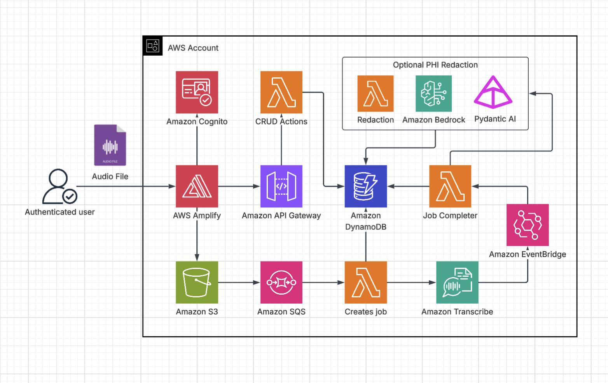

# Transcribly

| Index                         | Description                                         |
|:------------------------------|:----------------------------------------------------|
| [Overview](#overview)         | See what this project does and its key capabilities |
| [Demo](#demo)                 | View the demo video                                 |
| [Description](#description)   | Learn about the problem and our approach            |
| [Architecture](#architecture) | View the system architecture diagram                |
| [Tech Stack](#tech-stack)     | Technologies and services used                      |
| [Deployment](#deployment)     | How to install and deploy the solution              |
| [Usage](#usage)               | How to use the application                          |
| [Costs](#costs)               | Estimated AWS costs for running the solution        |
| [Credits](#credits)           | Meet the team behind this project                   |
| [License](#license)           | See the project's license information               |
| [Disclaimers](#disclaimers)   | Important legal disclaimers                         |

---

# Overview

**Transcribly** is a serverless audio transcription platform designed to help researchers quickly convert multi-speaker recordings into structured, searchable transcripts. The solution uses AWS Transcribe for speech-to-text with automatic speaker diarization, and an AI agent powered by Claude on Amazon Bedrock to detect and redact Protected Health Information (PHI) when needed.

**Key capabilities include:**

- **Multi-Speaker Transcription**: Automatically transcribe audio files with speaker diarization.
- **PHI Redaction**: Optionally enable HIPAA-compliant de-identification at upload time. An AI agent detects 18 HIPAA identifiers and redacts them before the transcript is saved. 
- **Transcript Management**: Transcripts support inline editing, speaker merging, automatic filler word filtering, etc. Browse, star, rename, and delete transcripts from a personal library. 
- **Synchronized Audio Playback**: Play back the original audio alongside the transcript, with per-segment seek, allowing users to jump directly to any speaker turn.

---

# Demo

https://github.com/user-attachments/assets/14c1813b-11a6-4a86-b9bd-0c687a76d8d3

---

# Description

## Problem Statement

Researchers are conducting interviews and to share and analyze the findings, they need to first transcribe the audio recording into text. Manual transcription is time-consuming, and using a third-party tool may require up to six months of approval process. Researchers need a tool that can quickly transcribe audio recordings, while also providing the option to redact sensitive information.

## Our Approach

Transcribly addresses these challenges through a serverless audio processing pipeline that automates transcription, speaker attribution, and HIPAA de-identification, giving teams fast, structured transcripts without manual effort or specialized tooling.

**Transcription Pipeline:** Audio files are uploaded directly from the browser to S3 using temporary, user-scoped Cognito credentials. An S3 notification routes the upload through SQS to a Lambda that submits the file to Amazon Transcribe with speaker diarization enabled. When the job completes, an EventBridge rule triggers a second Lambda that parses the raw output into a clean, segment-based format grouped by speaker turn, and indexes the result in DynamoDB so the frontend can display the transcript as soon as it is ready.

**AI-Powered PHI Redaction:** If a user enables de-identification at upload time, Claude Sonnet on Amazon Bedrock is invoked with a HIPAA-specialist prompt to detect all 18 HIPAA identifier categories across the transcript. Detected entities are redacted segment by segment, and a safety check verifies that no flagged entity survived. Transcripts where redaction could not be confirmed are saved with a `NEEDS_REVIEW` status rather than silently passing.

**Transcript Management and Cleanup:** Built-in post-processing filters filler words and collapses repeated phrases for a cleaner read. Users can rename, star, edit, and delete transcripts from a personal library, with inline editing capabilities that are saved back to S3 via the REST API.

**Serverless Infrastructure:** All backend components are Python Lambda functions deployed with AWS CDK behind an API Gateway REST API secured by a Cognito authorizer. Audio uploads bypass the API entirely. The browser writes directly to S3, and the rest of the pipeline is driven by native AWS events. 

---

# Architecture



---

# Tech Stack

Use a table to list all technologies and services. Group them into logical categories (e.g., AWS, Backend, Frontend).

| Category                      | Technology                                                                      | Purpose                                                          |
|:------------------------------|:--------------------------------------------------------------------------------|:-----------------------------------------------------------------|
| **Amazon Web Services (AWS)** | [Amazon S3](https://aws.amazon.com/s3/)                                         | Stores uploaded audio files and transcript JSON                  |
|                               | [Amazon Transcribe](https://aws.amazon.com/transcribe/)                         | Speech-to-text with automatic speaker diarization                |
|                               | [Amazon Bedrock](https://aws.amazon.com/bedrock/)                               | Hosts Claude Sonnet for AI-powered PHI detection                 |
|                               | [AWS Lambda](https://aws.amazon.com/lambda/)                                    | Serverless compute for the transcription and redaction pipeline  |
|                               | [Amazon API Gateway](https://aws.amazon.com/api-gateway/)                       | REST API for transcript CRUD operations                          |
|                               | [Amazon DynamoDB](https://aws.amazon.com/dynamodb/)                             | Stores transcript metadata and job status                        |
|                               | [Amazon SQS](https://aws.amazon.com/sqs/)                                       | Decouples S3 upload events from the transcription starter Lambda |
|                               | [Amazon EventBridge](https://aws.amazon.com/eventbridge/)                       | Triggers the completer Lambda when a Transcribe job finishes     |
|                               | [Amazon Cognito](https://aws.amazon.com/cognito/)                               | User authentication and per-user scoped S3 credentials           |
|                               | [AWS Amplify](https://aws.amazon.com/amplify/)                                  | Frontend hosting                                                 |
|                               | [AWS CDK](https://aws.amazon.com/cdk/)                                          | Infrastructure as code for all AWS resources                     |
| **Backend**                   | [Python 3.13](https://www.python.org/)                                          | Lambda function runtime                                          |
|                               | [pydantic-ai](https://ai.pydantic.dev/)                                         | AI agent framework for structured PHI detection via Bedrock      |
|                               | [boto3](https://boto3.amazonaws.com/v1/documentation/api/latest/index.html)     | AWS SDK for Python                                               |
| **Frontend**                  | [React](https://react.dev/)                                                     | UI framework for building the web interface                      |
|                               | [Vite](https://vite.dev/)                                                       | Frontend build and dev server                                    |
|                               | [TypeScript](https://www.typescriptlang.org/)                                   | Type-safe frontend development                                   |
|                               | [Tailwind CSS](https://tailwindcss.com/)                                        | Utility-first CSS framework for styling components               |

---

# Deployment

## Prerequisites

Before deploying, ensure you have the following prerequisites in place:
1. Sign up for an [AWS account](https://signin.aws.amazon.com/signup?request_type=register) if you haven't already.
2. **Node.js** (v20 or later) — [Download here](https://nodejs.org/en/download) or use [nvm](https://github.com/nvm-sh/nvm)
3. **AWS CDK** (v2) - install via `npm`:
   ```bash
   npm install -g aws-cdk
   ```
4. **AWS CLI** — [Installation Guide](https://docs.aws.amazon.com/cli/latest/userguide/getting-started-install.html)
5. **Docker** (running) — [Download here](https://www.docker.com/get-started/). Required by CDK to bundle Python Lambda functions.
6. **zip** and **curl** — standard system utilities
   - macOS: `brew install zip`
   - Linux: `sudo apt install zip`
   - Windows (Git Bash): `choco install zip` via [Chocolatey](https://chocolatey.org)
7. **Git** — [Download here](https://git-scm.com/). Windows users should run all scripts in **Git Bash** (included with Git for Windows) rather than Command Prompt or PowerShell.

AWS CDK is installed automatically as a local project dependency — no global install needed.

## AWS Configuration

Configure your credentials before running any deploy script:

```bash
aws configure
# or, for SSO:
aws sso login --profile <your-profile>
```

CDK bootstrap (one-time per AWS account/region) is run automatically by `deploy.sh` on first deploy. To skip it on subsequent runs pass `--skip-bootstrap`.

## Quick Start - Full Deployment (Recommended)

The root-level `deploy.sh` script handles everything in order: prerequisites check, AWS identity confirmation, infrastructure (CDK), then frontend (Amplify).

```bash
git clone https://github.com/pitt-cic/Transcribly.git
cd Transcribly

# Make scripts executable (Mac/Linux/Git Bash on Windows)
chmod +x deploy.sh infra/deploy-infra.sh frontend/deploy-frontend.sh frontend/setup-dev.sh

# First-time production deploy (prompts for confirmation)
./deploy.sh

# Dev deploy with a named profile
./deploy.sh --dev alice --stage dev --profile myprofile

# Production deploy, no prompts (e.g. CI)
./deploy.sh --stage prod --profile myprofile --yes
```

What the script does:

- Verifies Node.js, npm, Docker, AWS CLI, zip, and curl are present
- Warns and confirms if defaulting to a production target
- Displays and confirms the active AWS identity (once, shared across both phases)
- Deploys CDK infrastructure — DynamoDB, Lambda, API Gateway, Cognito, S3, and an Amplify App
- Builds the React frontend and deploys it to Amplify via zip upload
- Prints the live application URL on completion

### deploy.sh options

| Flag | Default | Description |
|:-----|:-------:|:------------|
| `--dev NAME` | — | Developer name (required for non-prod stacks) |
| `--stage STAGE` | `prod` | Deployment stage: `dev`, `beta`, or `prod` |
| `--profile NAME` | default | AWS CLI profile |
| `--branch NAME` | `main` | Amplify branch name for frontend deployment |
| `--skip-bootstrap` | off | Skip CDK bootstrap (use after first deploy) |
| `--require-approval LEVEL` | `broadening` | CDK approval level: `never`, `any-change`, `broadening` |
| `--skip-build` | off | Skip frontend build, deploy existing `dist/` |
| `--no-wait` | off | Don't poll for Amplify deployment completion |
| `--infra-only` | off | Deploy infrastructure only, skip frontend |
| `--frontend-only` | off | Deploy frontend only (infra must already exist) |
| `--yes` / `-y` | off | Skip all confirmation prompts |

If neither `--dev` nor `--stage` is provided, the script defaults to a production deployment and requires explicit confirmation.

## Manual Deployment (individual scripts)

### Infrastructure

```bash
cd infra
./deploy-infra.sh --stage prod --profile myprofile --yes
# or for dev:
./deploy-infra.sh --dev alice --stage dev --profile myprofile
```

Options mirror `deploy.sh`: `--dev`, `--stage`, `--profile`, `--skip-bootstrap`, `--require-approval`, `--yes`.

### Frontend

The frontend script reads CloudFormation outputs to generate the `.env.production` file automatically, then builds and uploads to Amplify.

```bash
cd frontend
./deploy-frontend.sh --stage prod --profile myprofile --yes
# or for dev:
./deploy-frontend.sh --dev alice --stage dev --profile myprofile
```

Additional frontend-only options: `--branch NAME`, `--skip-build`, `--no-wait`.

## Local Development

1. **Ensure the infrastructure stack has been deployed**, then run the setup script from the `frontend` directory:
   ```bash
   cd frontend
   ./setup-dev.sh --stage prod
   # or for a dev stack:
   ./setup-dev.sh --stage dev --dev alice
   ```
   This fetches CloudFormation outputs and writes them to `.env`, then installs npm dependencies.

2. **Start the development server**:
   ```bash
   npm run dev
   ```

---

# Usage

1. **Accessing the Application**

   Once deployed, access the web interface using the Amplify URL. Run the deploy script to view your application URL and other deployment details.

2. **User Registration**

   Transcribly uses admin-only user creation — self-signup is disabled. Register new users in the Amazon Cognito User Pool via the AWS Management Console. [Learn more about creating user accounts in Cognito](https://docs.aws.amazon.com/cognito/latest/developerguide/how-to-create-user-accounts.html).

3. **Login**

   Log in using the credentials created in the previous step. You will be prompted to change your password on first login.

4. **Uploading Audio**

   - **Select files**: Drag and drop or browse for audio files. Multiple files can be uploaded at once.
   - **PHI Redaction** *(optional)*: Toggle "Redact PHI" before uploading to automatically detect and redact HIPAA identifiers from the transcript.
   - **Upload**: Click "Upload & Transcribe". Files are uploaded directly to S3 and transcription begins immediately. The page polls for completion and shows a status indicator for each file.

5. **Viewing a Transcript**

   Once transcription is complete, open the transcript from the list. Each speaker turn is labeled and timestamped. Click any segment to seek the audio player to that point. Use the audio controls to play back the original recording alongside the text.

6. **Editing and Cleanup**

   - **Speaker labels**: Click any speaker name to rename it. Use merge mode to consolidate segments from the same speaker that were split across turns.
   - **Segment editing**: Click a segment to edit its text inline. Use find-and-replace to make bulk corrections across the transcript.
   - **Filler word filtering**: Toggle filler word filtering to automatically remove fillers from the display.

7. **Managing Transcripts**

   From the transcript list, star important recordings to filter them later, rename transcript titles inline, search by title, and delete transcripts you no longer need.

---

# Costs

## Estimated Monthly Recurring Costs

The following table shows baseline AWS infrastructure costs at low to no usage. The primary variable costs are Amazon Transcribe (per minute of audio) and Amazon Bedrock (only when PHI redaction is enabled).

| Service              | Estimated Cost    | Notes                                                          |
|:---------------------|:-----------------:|:---------------------------------------------------------------|
| AWS Lambda           | ~$0               | Free tier: 1M requests + 400,000 GB-seconds/month             |
| Amazon API Gateway   | ~$0               | $3.50/million API calls; negligible at low usage               |
| Amazon S3            | ~$0               | $0.023/GB; audio files and transcript JSON cost under $0.01   |
| Amazon DynamoDB      | ~$0               | Pay-per-request; free tier covers typical low usage            |
| Amazon SQS           | ~$0               | Free tier: 1M requests/month                                   |
| Amazon EventBridge   | ~$0               | Free for AWS service events                                    |
| Amazon Cognito       | ~$0               | Free up to 10,000 monthly active users                         |
| AWS Amplify          | ~$10–20           | Hosting and build minutes beyond the free tier                 |
| **Total Baseline**   | **~$10–20/month** | Excluding Transcribe and Bedrock usage                         |

## Per-Transcription Costs

### Amazon Transcribe

Transcribe is charged at **$0.024 per minute** of audio (standard rate, first 250,000 min/month).

| Audio Length | Transcribe Cost |
|:-------------|:---------------:|
| 15 minutes   | ~$0.36          |
| 30 minutes   | ~$0.72          |
| 60 minutes   | ~$1.44          |

### Amazon Bedrock — PHI Redaction (optional)

PHI redaction uses **Claude Sonnet 4.5** via Amazon Bedrock cross-region inference. Effective pricing (including the 10% cross-region multiplier) is **$3.30 per 1M input tokens** and **$16.50 per 1M output tokens**. 

| Audio Length | Approx. Input Tokens | Approx. Output Tokens | Approx. Cost |
|:-------------|:--------------------:|:---------------------:|:------------:|
| 15 minutes   | ~5,000               | ~200                  | ~$0.02       |
| 30 minutes   | ~10,000              | ~250                  | ~$0.04       |
| 60 minutes   | ~18,000              | ~300                  | ~$0.06       |

## Example Monthly Scenario

10 transcriptions averaging 45 minutes each, 5 with PHI redaction enabled:

| Line item                        | Quantity | Unit Cost | Subtotal    |
|:---------------------------------|:--------:|:---------:|:-----------:|
| Amazon Transcribe (45 min)       | 10       | ~$1.08    | ~$10.80     |
| PHI Redaction — Bedrock (45 min) | 5        | ~$0.05    | ~$0.25      |
| AWS infrastructure               | —        | —         | ~$10–20     |
| **Monthly total**                |          |           | **~$21–31** |

> **Note:** Cost estimates are based on AWS pricing as of September 2026. Token counts vary by audio length and speaking pace. Actual costs may differ.

---

# Credits

**Transcribly** is an open-source project developed by the University of Pittsburgh Health Sciences and Sports Analytics Cloud Innovation Center.

**Development Team:**

- [Vincent Zhu](https://www.linkedin.com/in/vincent-zhu1689/)
- [Tanishq Bansod](https://www.linkedin.com/in/tanishq-bansod/)

**Project Leadership:**

- **Technical Lead**: [Maciej Zukowski](https://www.linkedin.com/in/maciejzukowski/) - Solutions Architect, Amazon Web Services (AWS)
- **Program Manager**: [Kate Ulreich](https://www.linkedin.com/in/kate-ulreich-0a8902134/) - Program Leader, University of Pittsburgh Health Sciences and Sports Analytics Cloud Innovation Center
- **Program Manager**: [Dwight Helfrich](https://www.linkedin.com/in/dwight-helfrich-53a233b/) - Program Leader, University of Pittsburgh Health Sciences and Sports Analytics Cloud Innovation Center

**Special Thanks:**

- [Annette Vee](https://www.english.pitt.edu/people/annette-vee) — Associate Professor of English, Facilitator of AI in the Disciplines in the Dietrich School of Arts and Sciences, and Faculty Liaison for AI Enablement with Pitt Digital.

This project is designed and developed with guidance and support from the [Health Sciences and Sports Analytics Cloud Innovation Center](https://digital.pitt.edu/cic), powered by AWS.

---

# License

This project is licensed under the [MIT License](./LICENSE).

```plaintext
MIT License

Copyright (c) 2026 University of Pittsburgh Health Sciences and Sports Analytics Cloud Innovation Center

Permission is hereby granted, free of charge, to any person obtaining a copy
of this software and associated documentation files (the "Software"), to deal
in the Software without restriction, including without limitation the rights
to use, copy, modify, merge, publish, distribute, sublicense, and/or sell
copies of the Software, and to permit persons to whom the Software is
furnished to do so, subject to the following conditions:

The above copyright notice and this permission notice shall be included in all
copies or substantial portions of the Software.

THE SOFTWARE IS PROVIDED "AS IS", WITHOUT WARRANTY OF ANY KIND, EXPRESS OR
IMPLIED, INCLUDING BUT NOT LIMITED TO THE WARRANTIES OF MERCHANTABILITY,
FITNESS FOR A PARTICULAR PURPOSE AND NONINFRINGEMENT. IN NO EVENT SHALL THE
AUTHORS OR COPYRIGHT HOLDERS BE LIABLE FOR ANY CLAIM, DAMAGES OR OTHER
LIABILITY, WHETHER IN AN ACTION OF CONTRACT, TORT OR OTHERWISE, ARISING FROM,
OUT OF OR IN CONNECTION WITH THE SOFTWARE OR THE USE OR OTHER DEALINGS IN THE
SOFTWARE.
```

---

For questions, issues, or contributions, please visit our [GitHub repository](https://github.com/[org]/[repo]) or
contact the development team.

---

# Disclaimers

**Customers are responsible for making their own independent assessment of the information in this document.**

**This document:**  
(a) is for informational purposes only,  
(b) references AWS product offerings and practices, which are subject to change without notice,  
(c) does not create any commitments or assurances from AWS and its affiliates, suppliers or licensors. AWS products or
services are provided "as is" without warranties, representations, or conditions of any kind, whether express or
implied. The responsibilities and liabilities of AWS to its customers are controlled by AWS agreements, and this
document is not part of, nor does it modify, any agreement between AWS and its customers, and  
(d) is not to be considered a recommendation or viewpoint of AWS.

**Additionally, you are solely responsible for testing, security and optimizing all code and assets on GitHub repo, and
all such code and assets should be considered:**  
(a) as-is and without warranties or representations of any kind,  
(b) not suitable for production environments, or on production or other critical data, and  
(c) to include shortcuts in order to support rapid prototyping such as, but not limited to, relaxed authentication and
authorization and a lack of strict adherence to security best practices.

**All work produced is open source. More information can be found in the GitHub repo.**
